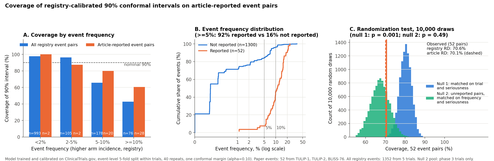
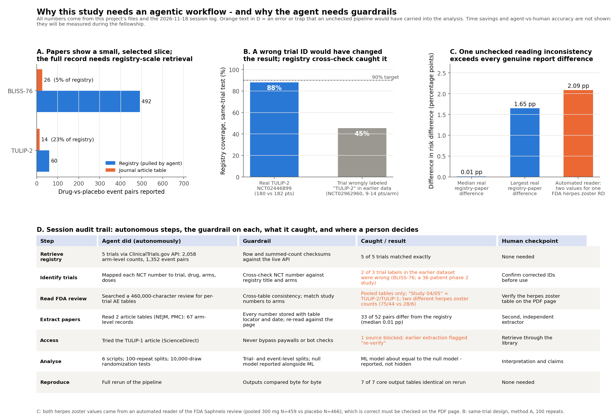

<div align="center">

# Same trial, different story

**Does a conformal guarantee earned on ClinicalTrials.gov survive in the journal article about the same trial?**

*A reproducible, agent-built, guardrailed pilot on lupus trials of anifrolumab and belimumab.*


</div>

---

## The question in one paragraph

One clinical trial produces several reports of its adverse events: the **ClinicalTrials.gov results record**, the
**journal article**, and sometimes the **FDA review**. They rarely say exactly the same thing, yet drug-safety models are
trained on one kind of report and used on the others. We ask a narrow, testable question: *if a model and its 90%
conformal prediction interval are trained and calibrated on one report of a trial, do the intervals still hold on
another report of that same trial?* The aim is to find where calibration breaks and why, not to claim that
conformal prediction guarantees coverage when the source shifts.

## Headline result (pilot, 3 trials, 52 matched events)

<p align="center"></p>

| Within one trial, intervals calibrated on the registry... | Coverage (target 90%) |
|---|---|
| on all registry events | **90.3%** - the guarantee holds |
| on the events the article chooses to report, using registry values | **69.8%** |
| on the same events, using the article's own numbers | **69.5%** |

* **The article's different numbers barely matter (−0.4 points).** Registry and article risk differences differ by a median
  of 0.01 percentage points (largest 1.65), far less than the intervals' slack.
* **What the article chooses to report matters a lot.** Articles list events above a frequency threshold (>5% or >=10%),
  so 92% of reported events have a frequency of 5% or more, against 16% of the others. Random sets of events from the same trials are
  covered 80% of the time. The article's events are covered 70.6% (randomization p = 0.001), which is what
  frequency-matched registry events show (67.3%).
* **A group-conditional (Mondrian) fix helps.** Calibrating serious and non-serious events separately brings common
  adverse events back to about 91% on both reports, at about twice the interval width.

> **In one sentence:** the registry and the article disagree mainly about *which* events they report, not about the numbers,
> and that selective reporting is enough to break an otherwise valid conformal guarantee.

A second test makes the trial new as well (leave-one-trial-out). Coverage there depends mostly on which trial is held out,
for example 5 of 10 common events for TULIP-2. See [`results/coverage_by_trial_source_method.csv`](results/coverage_by_trial_source_method.csv).

## Why conformal prediction is the right tool for this question

We do **not** claim conformal prediction is the best predictor. Our gradient-boosting model is no better than predicting
"no effect", and we report that. Conformal prediction is the right *measuring instrument* here, for four reasons:

1. **The guarantee is explicit.** Under exchangeability, split conformal intervals cover at least 1 − α of new cases in finite samples,
   for any model and any data distribution. Because the promise is exact, a shortfall is a measurement, not a matter of taste.
2. **The assumption is testable.** Exchangeability is the single assumption. A coverage gap between two reports of the same trial is therefore
   a direct readout of *non-exchangeability*, which we can then explain (here: selective reporting).
3. **The repairs are principled.** Mondrian (group-conditional) and source-conditional calibration are standard extensions with their
   own guarantees, so "fixing" coverage is not ad hoc tuning.
4. **It works with any model.** The same check applies to any safety model someone deploys, including large language models.

## Built with an AI agent, fenced in by guardrails

<p align="center"></p>

This project depends on an AI research agent for the work that does not scale by hand: pulling every registry record through the API,
lining registry rows up against article tables, carrying a source locator with every number, and rerunning a grid of analyses each
time a number changes. It depends equally on **guardrails**. In the first working session they caught:

| Guardrail | What it caught |
|---|---|
| Cross-check every NCT number against the registry title and arms | **2 of 3 trial labels** in an earlier internal dataset were wrong. One mislabeled "trial" was a 36-patient phase 2 study, with registry coverage of 45% against 88% for the real TULIP-2 |
| Cross-table consistency on FDA reviews | An automated PDF reading gave two different herpes zoster counts for one pooled population. The gap is 2.09 points of risk difference, bigger than any genuine registry-article difference |
| Match FDA study numbers to arms | FDA "Study 04" is TULIP-2 and "Study 05" is TULIP-1 |
| Never bypass paywalls or bot checks | One article was blocked; its earlier extraction is flagged **re-verify** |
| Row- and count-checksums against the live API | 5 of 5 trials matched exactly |
| Byte-level reproducibility | All outputs identical across two machines (Python 3.10 and 3.13) |

The rules agents follow in this repo are in [`AGENTS.md`](AGENTS.md); the session-by-session audit log
is at the end of the same file. We have **not** yet measured time saved or agent-versus-human extraction accuracy.
Both are planned outcomes (see the roadmap below).

## Data

| Trial | NCT | Drug / route | Registry | Article table | FDA review |
|---|---|---|---|---|---|
| TULIP-1 | NCT02446912 | anifrolumab IV 150/300 mg | 160 terms | Furie 2019 *Lancet Rheumatol*, 6 terms (**re-verify**) | pooled only |
| TULIP-2 | NCT02446899 | anifrolumab IV 300 mg | 60 terms | Morand 2020 *NEJM* Table 3, 14 terms | pooled only |
| BLISS-76 | NCT00410384 | belimumab IV 1/10 mg/kg | 246 terms | Furie 2011 *Arthritis Rheum* (PMC5007058) Table 3, 13 terms | to locate |
| BLISS-52 | NCT00424476 | belimumab IV 1/10 mg/kg | 165 terms | planned | to locate |
| D3461C00008 | NCT02962960 | anifrolumab SC, phase 2 (n = 36) | 75 terms | not planned | none |

Unit of analysis: risk difference RD = a/n<sub>1</sub> − c/n<sub>0</sub> for each trial × active arm × MedDRA term × seriousness
(1,352 registry pairs). Model inputs are drug, route, dose, term, organ class, seriousness, phase, follow-up and arm sizes.
Counts, rates and the source label are never inputs. Every number in `data/` carries its citation, table locator and retrieval date; no article text is reproduced.
Events an article does not report are recorded as *not reported*, never as zero.

## Repository layout

```
data/        registry_ctgov.csv · articles.csv · fda_reviews.csv   - every number with citation, locator and date
scripts/     00-07, run in order (see below)
results/     the 5 tables the README cites (main result: same_trial_cross_report_summary.csv)
figures/     selection_proof.png · agentic_workflow_evidence.png
build/       intermediate files, regenerated by make (not committed)
```

## Reproduce

```bash
pip install -r requirements.txt
make reproduce   # scripts 01-03 (under 10 s), then checks every output against checksums/expected.md5
make all         # everything, including 100-repeat and 10,000-draw analyses (about 4 min) and both figures
make excel       # documented .xlsx copy of every table (an About sheet plus a column dictionary)
```

| Script | What it does |
|---|---|
| `00_verify_ctgov.py` | Re-downloads registry results and compares them with `data/registry_ctgov.csv` (needs internet) |
| `01_build_pairs.py` | Builds registry and article risk-difference pairs with full provenance |
| `02_cross_source_conformal.py` | Leave-one-trial-out test: new trial *and* new report |
| `03_describe_misses.py` | Labels count, window, seriousness-split and omission differences for each miss |
| `04_make_documented_xlsx.py` | Writes a documented Excel copy of every table |
| `05_same_trial_cross_report.py` | **Main test:** same trial, other report (100 repeats) |
| `06_selection_proof.py` | Randomization test of the selective-reporting explanation, plus Figure 1 |
| `07_agentic_evidence_figure.py` | Figure 2, built from logged guardrail events |

## Limitations (stated up front)

* **Few independent trials** (3 with article tables, 52 matched events). Confidence intervals are wide and results are exploratory.
* The TULIP-1 article rows come from an earlier partial extraction and await re-verification. There has been one extractor so far.
* The FDA reviews found so far pool trials, so they enter only descriptively.
* The randomization test's frequency-matched null draws some high-frequency events with replacement (13 available for 28 slots).
* The model adds little over a null model. The contribution is the calibration audit, not the predictor.

## Status and roadmap

**Started:** November 2026 · **Current:** v0.1 pilot · **Target:** preprint by end of February 2027

## v0.1 - pilot (November 2026) ✅
- [x] Registry snapshots for 5 lupus trials, checksum-verified against the live API
- [x] Article tables for TULIP-2 and BLISS-76; partial TULIP-1
- [x] Same-trial cross-report test, leave-one-trial-out test, randomization test of selective reporting
- [x] Guardrails written down (`AGENTS.md`); audit log started
- [x] Byte-identical reproduction on two machines

## v0.2 - complete, checkable dataset (December 2026)
- [ ] Re-verify the TULIP-1 article table (library access); extract the BLISS-52 article
- [ ] Locate the Benlysta FDA clinical review; check the Saphnelo herpes zoster tables on the PDF page
- [ ] Post the extraction protocol on OSF **before** final extraction
- [ ] Double extraction: a human extractor plus an agent-assisted pass, reconciled; report agreement before reconciliation
- [ ] Target: 100-150 matched trial-event pairs across 4 phase 3 trials

## v0.3 - pre-specified analysis (January 2027)
- [ ] Same-trial coverage by report, trial and event category, with exact confidence intervals
- [ ] Sensitivity analysis: pairs with matching follow-up windows and denominators only
- [ ] Selection-aware calibration: frequency-stratified (Mondrian) and source-conditional margins
- [ ] Measure the agent workflow: extraction time and agent-versus-human agreement

## v1.0 - preprint and release (February 2027)
- [ ] medRxiv preprint with code, data and audit log
- [ ] Zenodo DOI for the release
- [ ] Template so another group can run the audit on a different drug class from a list of NCT numbers

## Cite

See [`CITATION.cff`](CITATION.cff). Author: **Arnab Mukherjee**, Oklahoma State University Center for Health Sciences.
Research agent: Claude (Anthropic), working under the rules in `AGENTS.md`. Every decision was reviewed by the author.
